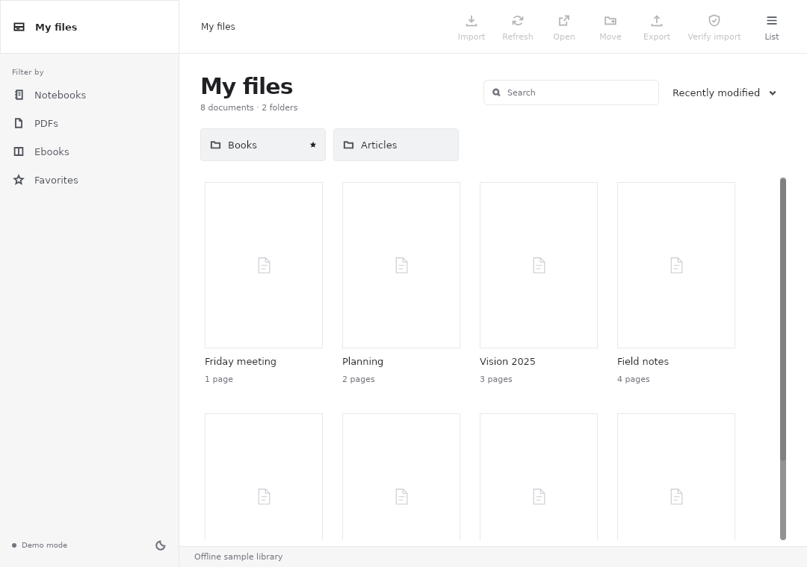

# TurboRM

An unofficial Linux desktop client for reMarkable tablets. Browse your reMarkable Cloud library, read notebooks and PDFs with your handwriting, import PDFs, EPUBs and images, move documents between folders, and export pages as PDF or SVG.



> **Disclaimer.** TurboRM is an independent, unofficial open-source project. It is not affiliated with, endorsed by, or supported by reMarkable AS. "reMarkable" is a trademark of reMarkable AS and is used only to identify the devices and cloud service this software works with. TurboRM talks to the reMarkable cloud through an undocumented protocol that it implements independently for interoperability; reMarkable may change that protocol at any time, which can break this software. Use it at your own risk and keep backups of your documents. This repository contains no reMarkable source code, firmware, fonts or templates.

TurboRM is experimental. It never deletes anything in your cloud library: every write only adds or moves entries, is verified after upload, and is refused by the server if the tablet changed the library at the same time.

## Install

TurboRM is written in Rust (1.92 or newer) with the [Slint](https://slint.dev) toolkit. On Debian/Ubuntu:

```sh
sudo apt install build-essential cmake pkgconf libfontconfig-dev libfreetype-dev libgl-dev libegl-dev libwayland-dev libxkbcommon-dev poppler-utils util-linux
git clone https://github.com/KihonNeko/TurboRM.git
cd TurboRM
./run-desktop.sh
```

`run-desktop.sh` builds the release binary and starts it. On first launch, follow the pairing link and enter the one-time code from your reMarkable account. Credentials are stored in your desktop keyring (GNOME Keyring, or KWallet with Secret Service), never in plain files.

Try it without an account:

```sh
./run-desktop.sh --demo
./run-desktop.sh --demo-viewer
```

The [desktop guide](turborm/README.md) covers features, paper templates, caching, menu integration and limits.

## Repository layout

```text
turborm/        Linux desktop app (Slint UI, viewer, renderer, `turborm review`)
turborm-core/   reMarkable Cloud library and the `turborm-cli` command-line client
skills/         Claude Code skill that sends documents to the tablet for handwritten review
```

## Claude Code skill

`skills/review-on-remarkable` sends a plan, Markdown file or HTML page to the tablet for a handwritten review through `turborm review`, then reads the annotations back. Install it with a link so it stays in sync with this copy:

```sh
ln -s "$PWD/skills/review-on-remarkable" ~/.claude/skills/review-on-remarkable
```

## Contributing

Issues and pull requests are welcome. Run `cargo test --workspace` and `cargo clippy --workspace --all-targets` before sending changes. Please never paste pairing codes, tokens or private document contents into issues.

## License

TurboRM is free software, licensed under the [GNU General Public License v3.0 or later](LICENSE).

Bundled third-party assets keep their own licenses: the Inter font is under the [SIL Open Font License 1.1](turborm/fonts/Inter-LICENSE.txt). Notebook format details were cross-checked against [rmscene](https://github.com/ricklupton/rmscene) (MIT).
